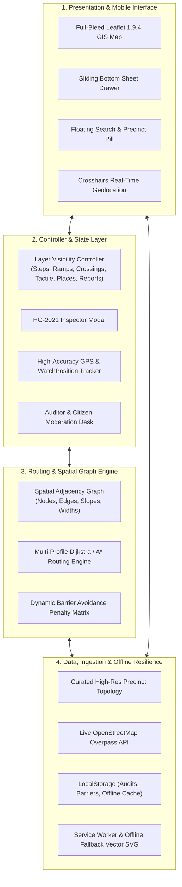
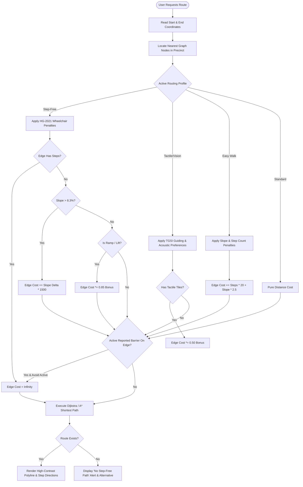
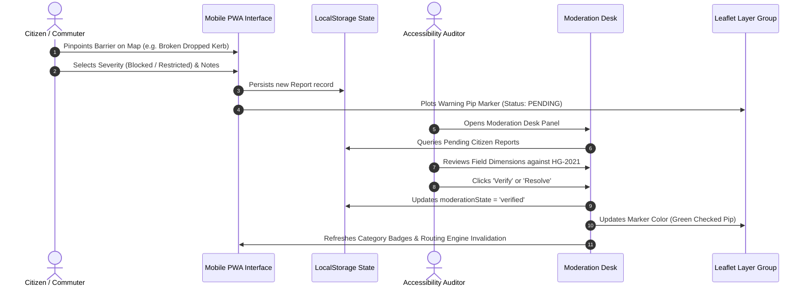

<div align="center">

# ♿ AccessMap India
### High-Precision Universal Pedestrian & Step-Free Navigation System
**Compliant with the Ministry of Housing & Urban Affairs (MoHUA) Harmonised Guidelines 2021 (HG-2021)**

[](https://render.com)
[](https://mohua.gov.in)
[](https://leafletjs.com)
[](#-offline-first--pwa-resilience)
[](LICENSE)
[](#-mobile-first-app-interface)

<p align="center">
  <a href="#-key-features">Key Features</a> •
  <a href="#-system-architecture">System Architecture</a> •
  <a href="#-routing-logic--algorithm">Routing Algorithm</a> •
  <a href="#-render-cloud-deployment-guide">Render Deployment</a> •
  <a href="#-mohua-hg-2021-compliance-matrix">HG-2021 Standards</a> •
  <a href="#-local-development">Local Setup</a>
</p>

---

</div>

## 📌 Executive Overview

**AccessMap India** is an open-source, mobile-first pedestrian navigation and spatial accessibility auditing platform engineered specifically for Indian urban contexts, healthcare facilities, and transit interchanges (featuring high-density precincts like the **AIIMS New Delhi Metro & Hospital Precinct**).

Unlike conventional navigation engines that optimize solely for vehicular travel or distance, AccessMap computes pedestrian journeys constrained by physical topography, stairs, ramp gradients, surface smoothness, dropped kerb vertical lips, tactile paving continuity, and real-time community-reported obstacles.

```
       Conventional Navigation                       AccessMap India
 ┌──────────────────────────────────┐      ┌──────────────────────────────────┐
 │  Distance: 320m                  │      │  Distance: 410m (Step-Free)      │
 │  Route: Direct flight of stairs  │  VS  │  Route: Continuous ramp & skywalk│
 │  ❌ Wheelchair: IMPASSIBLE       │      │  ✓ Wheelchair: 100% ACCESSIBLE   │
 │  ❌ Vision-Impaired: DANGEROUS   │      │  ✓ TGSI Tactile: FULL GUIDANCE   │
 └──────────────────────────────────┘      └──────────────────────────────────┘
```

---

## 🏗️ System Architecture

The application is structured into four cohesive layers, ensuring zero external framework overhead, instantaneous 0-second deployment builds, and pure client-side resilience.



---

## 🚀 Key Features

### 📱 Mobile-First App Interface
* **Dual Viewport Layout:** Full-bleed Leaflet interactive map at the top with an ergonomic draggable sliding bottom sheet drawer at the bottom.
* **Seamless View Modes:** Instant toggle between **Map Focus** (auto-collapsing the bottom drawer) and **List Focus** (expanding verified infrastructure rows).
* **Scroll Lock Protection:** Zero-shift viewport locks prevent iOS/Android viewport displacement or blank white voids during keyboard focus or switch toggling.

### 🎛️ Dynamic 6-Category Infrastructure Layer Controller
Audited precinct infrastructure is segregated into discrete vector layers that can be toggled on or off in real time without refreshing:
1. **Steps & Stairs:** Displays stair flights, step counts, and handrail status (`layers.steps`).
2. **Ramps & Elevators:** Highlights step-free gradient paths and lifts (`layers.ramps`).
3. **Crossings & Dropped Kerbs:** Maps pedestrian crossings with tactile blisters and flush kerbs (`layers.crossings`).
4. **Tactile Guiding Paths:** Identifies TGSI sinusoidal directional tiles (`layers.tactile`).
5. **Accessible Entrances:** Locates zero-step, wide doorways with clearance notes (`layers.places`).
6. **Community & Auditor Reports:** Real-time crowd-sourced barrier hazard pins (`layers.reports`).

### 🎯 Real-Time Geolocation Tracking & Navigation Icon
* **Crosshairs Floating Action Button:** One-tap navigation icon (`#locate-button`) to pan and zoom directly to your current location.
* **Real-Time Accuracy Ring:** Displays live GPS positioning and estimated radius circle.
* **Auto-Origin Setting:** Instantly assigns current GPS coordinates as the journey start node.

### 🧭 Multi-Profile Pedestrian Routing Engine (A*)
Four specialized routing modes tailored to distinct mobility profiles:
* **♿ Step-Free (Wheelchair / Pram):** Hard cutoff on stairs ($cost = \infty$), strictly enforces slopes $\le 8.33\%$ (1:12), penalizes uneven paving, and routes via elevators and ramps.
* **🦯 Tactile / Vision:** Prioritizes continuous tactile ground surface indicators (TGSI), avoids unprotected elevation drops, and favors crossings with acoustic signals.
* **🚶 Easy Walk:** Minimizes elevation changes and steep climbs for senior citizens and persons with heart conditions.
* **⚡ Standard Pedestrian:** Pure Euclidean distance optimization for unconstrained pedestrians.

### 🛡️ MoHUA HG-2021 Standards Inspector
* Direct modal inspection of any mapped feature against specific clauses of the **Harmonised Guidelines and Standards for Universal Accessibility in India (2021)**.
* Evaluates physical dimensions: ramp slope gradient, handrail height, tactile warning placement, and doorway clear openings.

### 📋 Citizen Barrier Auditing & Moderation Desk
* **In-the-Field Reporting:** Citizens can report broken kerbs, construction obstructions, or parked vehicles with severity levels: *Passable*, *Restricted*, or *Blocked*.
* **Auditor Verification:** Certified auditors can verify, resolve, or reject reports.
* **Data Portability:** 1-click export of audited precinct data to standard **GeoJSON** and **CSV**.

---

## 🧮 Routing Logic & Penalty Cost Matrix



---

## 🔄 Citizen Auditing & Moderation Lifecycle



---

## 📐 MoHUA HG-2021 Compliance Matrix

The system validates urban infrastructure against the **Harmonised Guidelines and Standards for Universal Accessibility in India (2021)** published by the Ministry of Housing and Urban Affairs (MoHUA):

| Infrastructure Element | MoHUA HG-2021 Clause | Mandatory Indian Standard | AccessMap Enforcement |
| :--- | :--- | :--- | :--- |
| **Pedestrian Walkway Width** | § 4.1 | $\ge 1200\text{ mm}$ (clear continuous), $1800\text{ mm}$ for passing | Enforced in path cost calculation; flags edges $< 1.2\text{m}$. |
| **Ramp Gradient** | § 4.3 | Max $1:12$ ($8.33\%$), $1:15$ to $1:20$ preferred for long spans | Slopes $> 8.3\%$ flagged non-compliant; heavily penalized in wheelchair mode. |
| **Kerb Ramps** | § 4.2 | Flush lip with road surface ($\le 15\text{ mm}$ rounded lip) | Avoids kerb drop steps; prioritizes pelican crossings. |
| **Stairs & Steps** | § 4.4 | Riser $\le 150\text{ mm}$, Tread $\ge 300\text{ mm}$, Handrails on both sides | Strict avoidance in Step-Free mode ($cost = \infty$). |
| **Tactile Guiding (TGSI)** | § 4.5 | Sinusoidal guiding & hazard blister warning tiles | 50% routing cost discount in Vision/Tactile mode. |
| **Building Entrances** | § 5.1 | Level entrance or ramped approach, doorway width $\ge 900\text{ mm}$ | Audited entrance feature cards with door width verification. |

---

## ☁️ Render Cloud Deployment Guide

This repository is optimized for **1-click automated deployment on [Render](https://render.com)**.

### Deployment Method A: Blueprint Deployment (Recommended)
1. Fork or push this repository to your GitHub account:
   `https://github.com/smahammadarshad08-debu/conclaveindia.git`
2. Log into the **[Render Dashboard](https://dashboard.render.com/)**.
3. Click **New +** $\rightarrow$ **Blueprint**.
4. Connect your GitHub repository.
5. Render will automatically read [`render.yaml`](render.yaml) and configure:
   * **Service Name:** `accessmap-india`
   * **Runtime:** Python
   * **Build Command:** `pip install -r requirements.txt`
   * **Start Command:** `python server.py`
   * **Health Check Path:** `/healthz`
6. Click **Apply**. Your service will be live in seconds at `https://<your-app>.onrender.com`!

### Deployment Method B: Manual Web Service
If setting up manually in Render without Blueprints:
* **Environment:** `Python`
* **Region:** Any (e.g., `Oregon (US West)` or `Frankfurt (EU Central)`)
* **Branch:** `main`
* **Build Command:** `pip install -r requirements.txt` (or leave empty)
* **Start Command:** `python server.py` *(or `python start`)*
* **Environment Variables:**
  * `PORT` = `10000` *(Render sets this automatically)*
* **Health Check Path:** `/healthz`

### Deployment Method C: Render Static Site
If you prefer pure CDN hosting without a Python container:
* **Environment:** `Static`
* **Build Command:** `echo "Static build ready"`
* **Publish Directory:** `accessmap-site`

---

## 💻 Local Development

### Prerequisites
* **Python 3.9+** (Standard installation, no third-party pip packages needed)
* Any modern web browser

### Quick Launch
Clone the repository and run the built-in production server:

```bash
# 1. Clone repository
git clone https://github.com/smahammadarshad08-debu/conclaveindia.git
cd conclaveindia

# 2. Launch production web server
python server.py
```

The application will be accessible at:
```
http://localhost:10000/
```

### Windows 1-Click Launchers
For Windows users, pre-configured launcher scripts are provided:
* Double-click [`Start-AccessMap.bat`](Start-AccessMap.bat)
* Or execute in PowerShell:
  ```powershell
  .\Start-AccessMap.ps1
  ```

---

## 📂 Repository File Structure

```
conclaveindia/
├── .github/
│   ├── ISSUE_TEMPLATE/
│   │   ├── bug_report.md             # Standardized bug reporting form
│   │   ├── feature_request.md        # Feature request template
│   │   └── barrier_report.md         # Field infrastructure hazard template
│   └── PULL_REQUEST_TEMPLATE.md      # PR guidelines & HG-2021 verification
├── accessmap-site/
│   ├── app.js                        # Core GIS routing, layer toggles & state
│   ├── index.html                    # Mobile-first semantic UI application
│   ├── styles.css                    # Responsive styling, sheet drawer & themes
│   ├── manifest.json                 # Web App Manifest (PWA installation)
│   ├── map-preview.svg               # Vector precinct overview graphic
│   ├── server.py                     # Local precinct server
│   ├── start                         # Local precinct unix launcher
│   ├── Start-AccessMap.bat           # Local Windows batch script
│   └── Start-AccessMap.ps1           # Local PowerShell script
├── .gitignore                        # Comprehensive Python, Node, OS ignore rules
├── CODE_OF_CONDUCT.md                # Contributor Covenant v2.1
├── CONTRIBUTING.md                   # Development & HG-2021 contribution guide
├── index.html                        # Root redirect & CDN fallback entrypoint
├── LICENSE                           # Open-source MIT License
├── Procfile                          # Heroku / PaaS process declaration
├── README.md                         # Project documentation & visual guide
├── render.yaml                       # Render Blueprint declaration (Web & Static)
├── requirements.txt                  # Python dependencies declaration (0 external)
├── SECURITY.md                       # Coordinated vulnerability disclosure policy
├── server.py                         # Production server with /healthz endpoint
├── start                             # Render executable entrypoint with shebang
├── Start-AccessMap.bat               # Root Windows launcher batch script
└── Start-AccessMap.ps1               # Root Windows PowerShell launcher script
```

---

## 📶 Offline-First & PWA Resilience

1. **Vector SVG Map Engine:** When network tile services are unreachable or direct file inspection is used, the system transparently activates an SVG vector fallback engine (`offline-svg-map`) rendering precinct geometry.
2. **PWA Manifest:** Installs as an independent native app on iOS Safari and Android Chrome via [`manifest.json`](accessmap-site/manifest.json).
3. **Local State Persistence:** Auditor verifications, custom barrier additions, and map preferences remain cached across browser sessions via `localStorage`.

---

## 🤝 Contributing

We welcome contributions from accessibility advocates, urban designers, software engineers, and civic data auditors!
Please read our [Contributing Guidelines](CONTRIBUTING.md) and [Code of Conduct](CODE_OF_CONDUCT.md) before submitting a Pull Request.

---

## 📜 Citations & Attributions

* **Harmonised Guidelines and Standards for Universal Accessibility in India (2021)**: Ministry of Housing and Urban Affairs (MoHUA), Government of India.
* **Map Data & Tiles**: &copy; [OpenStreetMap Contributors](https://www.openstreetmap.org/copyright) under ODbL.
* **Leaflet GIS Engine**: Vladimir Agafonkin & Leaflet contributors under BSD-2-Clause.

---

## ⚖️ License

Distributed under the **MIT License**. See [`LICENSE`](LICENSE) for full details.
