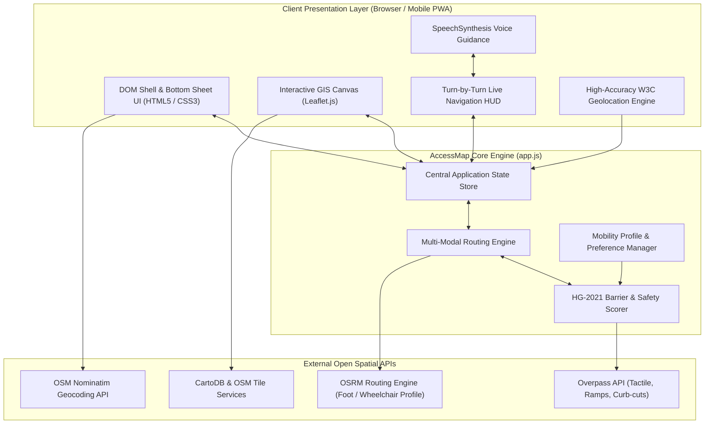
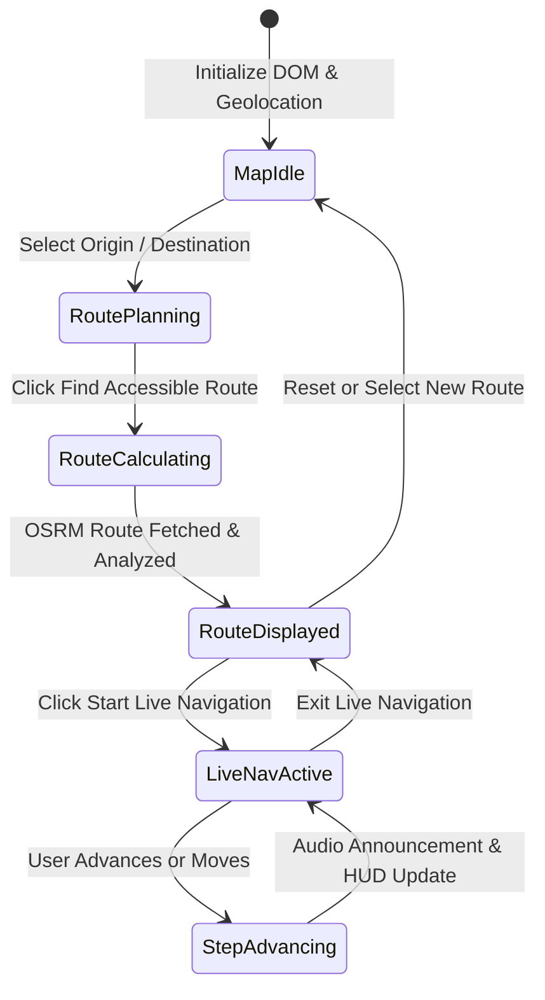

# AccessMap India — System Architecture & Data Flow

This document outlines the high-level system architecture, component relationships, data flow models, and mobile sheet state machine of **AccessMap India**.

---

## 1. High-Level Architectural Overview

---

## 2. Core Modules

### 2.1 Presentation & Interaction Engine
- **Leaflet Map Container**: Renders base maps (CartoDB Positron, OSM Standard) with custom accessible markers for elevators, tactile paving, curb-cuts, and ramps.
- **Responsive Mobile Bottom Sheet**: Touch-draggable pane with three discrete snap positions (`collapsed`, `mid`, `expanded`), driven by CSS transforms and passive touch event listeners.
- **Live Navigation HUD**: Head-Up Display pinned above the map displaying upcoming turns, distances, accessibility notes, and dynamic progress docks.

### 2.2 Navigation & Routing Pipeline
1. **Origin & Destination Selection**: Resolves user queries via Nominatim geocoding or HTML5 High-Accuracy GPS coordinates.
2. **Accessible Pathway Query**: Contacts the Open Source Routing Machine (OSRM) with footway and wheelchair impedance weights.
3. **MoHUA HG-2021 Constraint Filter**: Evaluates surface types, max gradient thresholds ($\le 1:12$), tactile indicators, and step counts.
4. **Step-by-Step Directions Formulation**: Generates rich maneuver instructions, visual arrow metadata, distance calculations, and audio strings.
5. **Turn-by-Turn Voice Dispatch**: Dispatches spoken announcements via the browser `window.speechSynthesis` API at each route waypoint.

---

## 3. State Management Lifecycle

